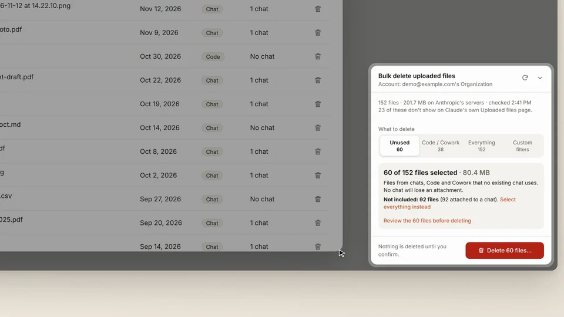

# Claude bulk delete uploads

Anthropic keeps the files you attach in claude.ai chats and Cowork until you delete them, along with files sent to or from Claude Code cloud and Remote Control sessions. You can see them under Settings → Privacy → Uploaded files ([open the page](https://claude.ai/new#settings/data-privacy-controls/uploaded-files)).

You may need to delete the stored files for privacy or compliance, for example client files uploaded with a personal Claude subscription. The page only deletes one file at a time, and its list leaves out some Code and Cowork files, so those can't be deleted there at all.

This userscript lists every file and deletes the ones you choose in one go. It works on personal plans. In Team and Enterprise workspaces, Claude hides the Uploaded files page from members and admins control the files, so the script shows a notice and deletes nothing.

**[Try the live demo](https://mo-haggag.github.io/claude-bulk-delete-uploads/demo/)**. It runs this script on a copy of the page with 152 fake files, so nothing touches your Claude account. Unofficial. Not affiliated with Anthropic.



## Install

A userscript is a small script that a browser extension runs on the websites you choose. You install the extension once, then add scripts to it. This script runs only on claude.ai.

1. Install a userscript manager:
   - **Firefox:** [Violentmonkey](https://violentmonkey.github.io/) or [Tampermonkey](https://www.tampermonkey.net/).
   - **Chrome, Edge, Brave:** Violentmonkey or Tampermonkey. Then turn on the extension's **Allow User Scripts** switch and reload claude.ai. Without the switch, scripts don't run and you get no error. If the panel doesn't appear, reload once more.
     - **Chrome:** to open the page with the switch, paste `chrome://extensions/?id=jinjaccalgkegednnccohejagnlnfdag` (Violentmonkey) or `chrome://extensions/?id=dhdgffkkebhmkfjojejmpbldmpobfkfo` (Tampermonkey) into the address bar.
     - **Edge, Brave:** open `edge://extensions` or `brave://extensions` and click **Details** under the extension.
2. Open **[claude-bulk-delete-uploads.user.js](https://raw.githubusercontent.com/mo-haggag/claude-bulk-delete-uploads/main/claude-bulk-delete-uploads.user.js)**. The extension shows an install page. Click **Install**. The extension keeps the script updated from this repo.
3. Open claude.ai → Settings → Privacy → **Uploaded files**. If the panel appears in the bottom-right corner, it works.

Websites can't detect browser extensions, so the panel appearing is the only way to confirm the install.

Tested in Firefox with Violentmonkey, and in Google Chrome 157 with Violentmonkey 2.50. Greasemonkey isn't supported.

## Use

1. **Pick what to delete.**
   - **Unused:** no chat uses the file. This is the default.
   - **Code / Cowork:** files Claude tags as Code or Cowork. Files sent through Remote Control are tagged Chat, so use Unused or Everything for those.
   - **Everything:** every file in the account.
   - **Custom:** filter by source, by chat use, and by age.
2. **Untick files to keep** (optional). Open the list to see each file.
3. **Confirm.** You type `DELETE` when chats would lose an attachment, or when you delete everything.
4. **Keep the tab open** until it finishes. **Stop** halts it.
5. **Check the result.** At the end it scans again, deletes any matching files that turned up late, and shows the final count.

Reload the page to refresh Claude's table.

## Safety

- Nothing is deleted until you confirm.
- It deletes one file first and checks it's gone before doing the rest.
- It stops after 5 failed deletes in a row, or if you're signed out.
- If Claude rate-limits it, it waits and retries.
- It asks before you leave the page during a run.
- It only sends requests to claude.ai.

## Limits

- **Chats stay:** deleting a file doesn't delete the chat. Text Claude already read from the file stays in the chat.
- **Local copies stay:** files sent to a Remote Control session are also saved on your computer in `~/.claude/uploads/`. This script doesn't touch them.
- **The API can change:** it uses claude.ai's internal API, which can change without notice. If a request fails, it stops and shows the error.

## How it works

- **Code:** the whole tool is one file with no dependencies, [`claude-bulk-delete-uploads.user.js`](claude-bulk-delete-uploads.user.js).
- **Finding files:** it lists files with `GET /api/organizations/{org}/account/files`, first 50 per page like the page does, then 1 per page, which returns all of them. The second pass splits the dates into ranges and reads them in parallel.
- **Deleting:** it sends the same request the page sends, `DELETE /api/organizations/{org}/account/files/{file_uuid}` with `{"fileUuid": "…"}`, 3 at a time.
- **Account:** it works on the account currently selected in claude.ai. The panel shows its name.
- **Live demo:** `demo/` holds the demo page. It loads the same script and answers its requests with a fake API that keeps 152 fake files in your browser. **Reset demo files** puts them back. To run it locally, from the repo folder:

  ```sh
  python3 -m http.server 8000
  # open http://localhost:8000/demo/
  ```

## License

[MIT](LICENSE)
